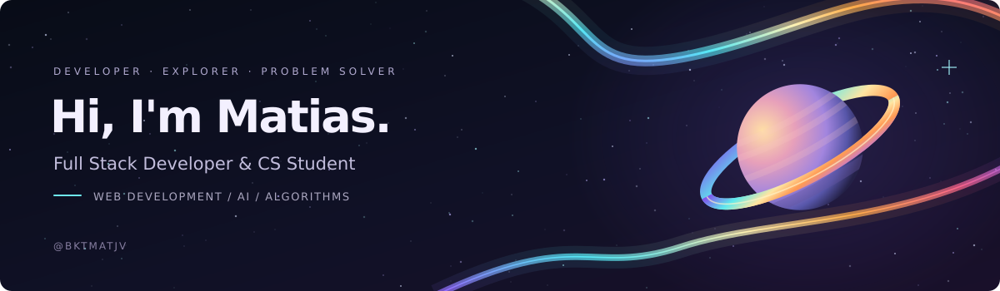
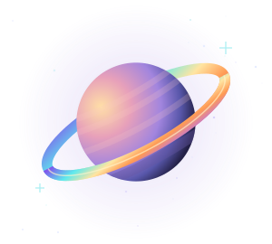
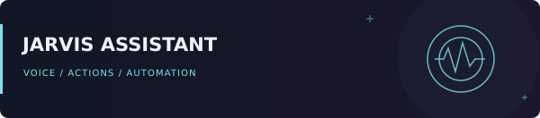
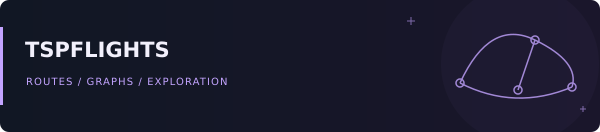
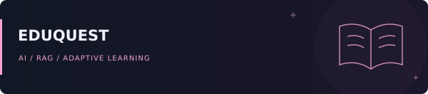
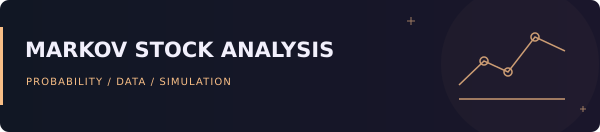

  

  <a href="#about-me">About</a> &nbsp; / &nbsp;
  <a href="#featured-projects">Projects</a> &nbsp; / &nbsp;
  <a href="#technologies">Stack</a> &nbsp; / &nbsp;
  <a href="#competitive-programming">Problem solving</a> &nbsp; / &nbsp;
  <a href="#lets-connect">Connect</a>

  
  
  

## About me

I'm **Matias Javier Del Castillo Mendoza**, a third-year **Computer Science student at Universidad Peruana de Ciencias Aplicadas (UPC)**, based in Peru 🇵🇪.

I enjoy taking an idea through the whole development process: designing the interface, building the API, modeling the data and understanding the algorithms behind it.

My interests meet at **full stack development, AI engineering and competitive programming**. I like building software that does something useful, whether that means planning routes, automating a desktop task or making an application easier to use.

- **Building with:** React, Vite, NestJS, FastAPI and relational databases.
- **Exploring:** machine learning, neural networks and LLM-based agents.
- **Practicing:** algorithms and data structures in C++.
- **Learning style:** build it, understand it, explain it, improve it.

 

> I care about understanding the decisions behind the code: what works, why it works and how it can be improved.

## What I enjoy building

<table>
  <tr>
    <td width="33%" valign="top">
      <h3>✦ Web applications</h3>
      
Interfaces, APIs and databases that work together. I enjoy connecting the frontend experience with the backend logic.

      
React · NestJS · PostgreSQL

    </td>
    <td width="33%" valign="top">
      <h3>✦ AI &amp; automation</h3>
      
Assistants that can use tools, respond to voice and carry out tasks. I'm also studying the ML foundations behind intelligent systems.

      
Python · FastAPI · LLMs

    </td>
    <td width="33%" valign="top">
      <h3>✦ Algorithms &amp; data</h3>
      
Graph problems, optimization and data-driven experiments. I like translating a problem into a model I can reason about.

      
C++ · Graphs · Pandas

    </td>
  </tr>
</table>

## Featured projects

<table>
  <tr>
    <td width="50%" valign="top">
      
      <h3><a href="https://github.com/bktmatjv/jarvis-desktop-asistant">Jarvis Assistant ↗</a></h3>
      
<strong>A desktop assistant that takes action.</strong>

      
A client-server assistant with voice and text interaction, LLM tool calling and scheduled tasks.

      <ul>
        <li>Real-time client updates through WebSockets.</li>
        <li>Offline wake-word recognition with Vosk.</li>
        <li>Human confirmation for sensitive actions.</li>
      </ul>
      
Python · FastAPI · React · Vosk · APScheduler

    </td>
    <td width="50%" valign="top">
      
      <h3><a href="https://github.com/bktmatjv/TSPFlights">TSPFlights ↗</a></h3>
      
<strong>Flight routes through graph algorithms.</strong>

      
An air route planner built around airport data, connectivity checks and Hamiltonian cycles.

      <ul>
        <li>Airport and route data from OpenFlights.</li>
        <li>Graph traversal and connectivity analysis.</li>
        <li>Geographic distance calculations with Haversine.</li>
      </ul>
      
Python · Flask · SQLite · JavaScript · Pandas

    </td>
  </tr>
  <tr>
    <td width="50%" valign="top">
      
      <h3><a href="https://github.com/Eduquest-org/eduquest-app">EduQuest ↗</a></h3>
      
<strong>AI-powered university admission preparation.</strong>

      
A gamified learning platform with personalized study routes and an Express API powering its AI features.

      <ul>
        <li>Adaptive learning routes with RAG, Groq and Pinecone.</li>
        <li>Quizzes, progress tracking and gamification.</li>
        <li>Authentication and application data through Supabase.</li>
      </ul>
      
JavaScript · Node.js · Express · Supabase · Groq · Pinecone

      
<a href="https://github.com/Eduquest-org/eduquest-app">Frontend ↗</a> &nbsp; · &nbsp; <a href="https://github.com/bktmatjv/eduquest-backend">AI Backend ↗</a>

    </td>
    <td width="50%" valign="top">
      
      <h3>Markov Stock Analysis</h3>
      
<strong>Exploring stock movements with probability.</strong>

      
A team project modeling upward, downward and stable price movements with Markov chains.

      <ul>
        <li>Historical data collection with yfinance.</li>
        <li>Transition matrices and state simulations.</li>
        <li>Stationary distribution analysis.</li>
      </ul>
      
Python · yfinance · Markov chains · Probability

    </td>
  </tr>
</table>

## Technologies

  
  
  
  
  
  
  
  
  
  
  
  
  
  
  
  
  
  
  

## Competitive programming

I enjoy **competitive programming** and solving problems in **C++**. I enjoy the process of finding a useful observation, choosing an algorithm and turning it into a solution under time constraints.

**Topics I practice:** greedy algorithms, binary search, dynamic programming, graph traversal, shortest paths, disjoint sets and range queries.

**What it teaches me:** reasoning about correctness, analyzing complexity, testing edge cases and staying persistent when the first approach fails.

  

 

## Learning orbit

| Direction | What I'm working toward |
| :--- | :--- |
| **Full stack engineering** | Building complete applications and understanding the tradeoffs across interfaces, APIs and data models. |
| **Machine learning** | Strengthening the math, data preparation and evaluation foundations before moving deeper into neural networks. |
| **AI engineering** | Connecting LLMs to tools, application state and useful actions. |
| **Problem solving** | Improving algorithm selection, complexity analysis and consistency in competitive programming. |

  
<strong>How I approach a project</strong>

   
  <ol>
    <li><strong>Understand the problem.</strong> Identify the user, the goal and the constraints.</li>
    <li><strong>Build a working version.</strong> Connect the core interface, logic and data.</li>
    <li><strong>Question the decisions.</strong> Check edge cases, complexity and assumptions.</li>
    <li><strong>Explain and improve.</strong> Document what I learned and use it in the next iteration.</li>
  </ol>

## GitHub activity

  

  
  

## Let's connect

I'm interested in conversations and collaborations around **web applications, AI assistants, data projects and competitive programming**.

  
  
  
  

 

